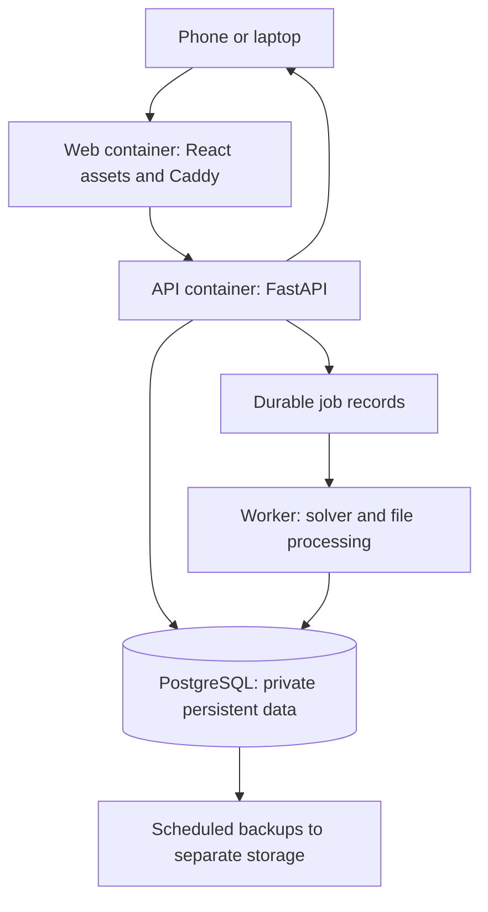

# Application architecture

Status: the foundation implements web/API/database services, a heartbeat-only worker, one-off migrations, authentication, viewer administration and inventory. Dependencies are locked and base images are pinned by digest. Solver jobs, live events, imports and backups in the broader design below remain planned. See STATUS.md for verification evidence.

## Components

| Component | Proposed implementation |
| --- | --- |
| Frontend | React, TypeScript, Vite, React Flow; custom guest/family drag-and-drop and tap-to-assign |
| Backend | Python/FastAPI with typed request/response schemas |
| Database | PostgreSQL; SQLAlchemy data access; Alembic migrations |
| Solver | OR-Tools CP-SAT in a separate worker process/container |
| Web entry | Caddy serving compiled assets and reverse-proxying API/live requests |
| Jobs | PostgreSQL-backed durable jobs, claimed transactionally with leases/retries; no external broker needed initially |
| Live updates | Proposed server-sent events plus normal HTTP mutation requests; reconnect performs a fresh authorised read |

The API and worker share one versioned backend image and different entry points. The frontend is compiled in a Docker build stage; a host Node/Python installation is not required to run production. API/worker run as non-root where practical. Do not mount the Docker socket.

## Interface

Desktop: guest list left, hotel topology centre, live summary right; date/night/hotel filters and actions above. Phone: switchable panels and tap-to-assign alongside drag-and-drop. Visual room positions remain fixed in allocation mode; owner-only layout-edit mode changes geometry.

Store actual room relationships separately from drawing coordinates. Ground-floor/restaurant access and corridor relationships are facts, not distances inferred from a diagram. Initial map is a schematic based on the supplied workbook, not a surveyed floor plan.

## Shared validation

A single backend rules module validates proposed manual moves, imports, solver output, and applied assignments. The frontend may preview checks but is not the authority. Manual moves convert planning conflicts into visible advisory warnings; the solver still uses those rules as constraints. Referential integrity, unique guest-night assignment, revision safety, authorization and fixed physical inventory remain enforced.

A manual placement records the exact change, warning IDs, acting editor and data revision in the audit history. Its owner-bound preview expires and is revalidated at apply time. No per-warning checkbox or implicit sharing-compatibility relationship is required. Existing manual exceptions do not prevent unrelated guest, import or room-setting edits; new conflicts introduced by those other workflows still receive their own validation.

## Automatic assignment

1. Snapshot current inputs and revision, dates, reservations, and locks.
2. Build allowed guest-room-night domains; couple/guardian relationships and staff category constrain domains.
3. Apply mandatory rules. Score preferences and produce a feasible proposal within a bounded time.
4. Report feasible/optimal/infeasible/timeout accurately. An incomplete result retains visible unassigned guests.
5. Owner reviews proposal and cost/violation differences.
6. Apply accepted proposal in one transaction after fresh authorization and revision/rule validation. Preserve the previous plan/history.

Proposed preference order: accessibility and mandatory constraints, coupled/linked-child grouping, nearby requests, side/group preferences, then unnecessary room usage. Exact weights, tie-breaking, and priority between otherwise valid alternatives are not owner-finalised.

## Authentication and authorization

Implemented foundation: username/password with Argon2id hashes, hashed server-side session tokens, HTTP-only SameSite cookies, CSRF checks, session expiry/revocation, persistent login throttling and no-store API responses. Private-key bootstrap creates the sole owner transactionally; there are no default credentials or public registration. Cookie security is enforced for production HTTPS; the loopback preview has an explicit local transport mode. Account recovery remains open.

The protected owner account and explicitly granted full editors may mutate planning/settings/access records. Family viewers have side scopes; reception has an operational field allowlist excluding costs. Scope API response schemas, event payloads, errors, and exports before transmission. No public guest-data endpoints or public self-registration.

## Consistency and live views

Use revision numbers for optimistic concurrency across owner/editor tabs and devices. Commit room moves/swaps atomically, including history and update notification records. Never show an optimistic move as saved until the server confirms it. Recovery/reconnect reloads current data; no promise of offline editing.

## Docker deployment

- Four long-running services: web, api, worker, db. Backup jobs and database migrations are separate scheduled/one-off operations.
- Separate development and production Compose settings; production uses built versioned images, health checks, restart policies, and internal networks.
- PostgreSQL is not published directly to the internet. Only web ingress is exposed. HTTPS terminates at Caddy or a chosen existing trusted proxy, depending on deployment.
- Database, authorised uploads, and certificate/config state use persistent volumes. Secrets are provided outside images/source using restricted mounted files/Compose secrets; host source files still need protection.
- Apply migrations once before new application services become ready. Fail deployment on migration errors.
- Dedicated VM 9601 has 4 vCPU, 4 GiB RAM and 40 GiB local-lvm storage under the owner's infrastructure instruction; see INFRASTRUCTURE.md and private VM_NOTES. Shared HTTPS ingress remains pending. Backup was explicitly deferred by the owner while foundation implementation proceeds.
- Pin dependencies/images at implementation; retain lockfiles and provenance. Do not claim a production version from an untested floating latest tag.

## Backups and upgrades

Schedule PostgreSQL logical backups and necessary private file/config backups, encrypt/access-control them, and copy off-host. Retention and recovery targets are open. Test restore to an isolated database and validate usable application data. A Docker volume is persistence, not an independent backup.

Before upgrades, back up data, apply compatible migrations, perform health/functional checks, and retain previous images. Database rollback may require a compatible forward fix or restoring the pre-upgrade backup; an old image alone is not a complete rollback.

## Import/export

Owner-only imports parse into private staging, show columns/duplicates/unknown ages/rates and proposed changes, and apply only after review. Re-imports use stable IDs rather than names alone. Sanitize spreadsheet-formula-like user text on export. Exports are filtered by the requesting user's scope and field visibility.

## References

- [Docker Compose production](https://docs.docker.com/compose/how-tos/production/)
- [Docker persistent volumes](https://docs.docker.com/engine/storage/volumes/)
- [Compose secrets](https://docs.docker.com/compose/how-tos/use-secrets/)
- [FastAPI Docker deployment](https://fastapi.tiangolo.com/deployment/docker/)
- [React Flow](https://reactflow.dev/learn)
- [Google OR-Tools CP-SAT](https://developers.google.com/optimization/cp/cp_solver)
- [PostgreSQL ranges](https://www.postgresql.org/docs/current/rangetypes.html)
- [PostgreSQL logical backups](https://www.postgresql.org/docs/current/backup-dump.html)
- [OWASP password storage](https://cheatsheetseries.owasp.org/cheatsheets/Password_Storage_Cheat_Sheet.html)

FET supplied inspiration for conditional constraints. This design proposes OR-Tools and independently written application rules; it does not embed FET code.

## Implemented planning design (schema 0002)

The earlier logical model is a design map. The deployed implementation uses `plan_state` for the transaction revision/history cursor; `families` and stable `guests` slots; `planning_resources` for room/bed flags and schematic positions; and `assignments` keyed by guest plus one of the two event nights. This fixed event does not implement arbitrary date-range stays. `room_locks`, `guest_links`, verified `room_connections`, and typed `planning_rules` feed the same validator used for manual previews, imports, history and solver application.

`pending_changes` hold short-lived owner/revision-bound import or assignment previews. `plan_changes` and `bill_snapshots` are append-only to the runtime role. `allocation_runs` holds the private snapshot, lease/attempt state and reviewable result. `meal_attendance`, `guest_presence`, `function_events` and `event_attendance` distinguish planned meals/functions from actual attendance and actual arrival timestamps. `billing_settings` and explicit `hotel_charge_days` hold missing/provisional price inputs alongside the foundation `event_policy`. Source does not contain real runtime records.

The allocator uses CP-SAT in the separate worker, with whole-family units, hard domain/capacity/compatibility/lock constraints, and bounded preference scoring. Every returned proposal is validated again by the shared rules and accepted through the same revision-safe preview/apply path. SSE emits only a revision and session-expiry signal; entity data is fetched again through scoped endpoints. This release does not implement a transactional event outbox or arbitrary FET rule execution.
